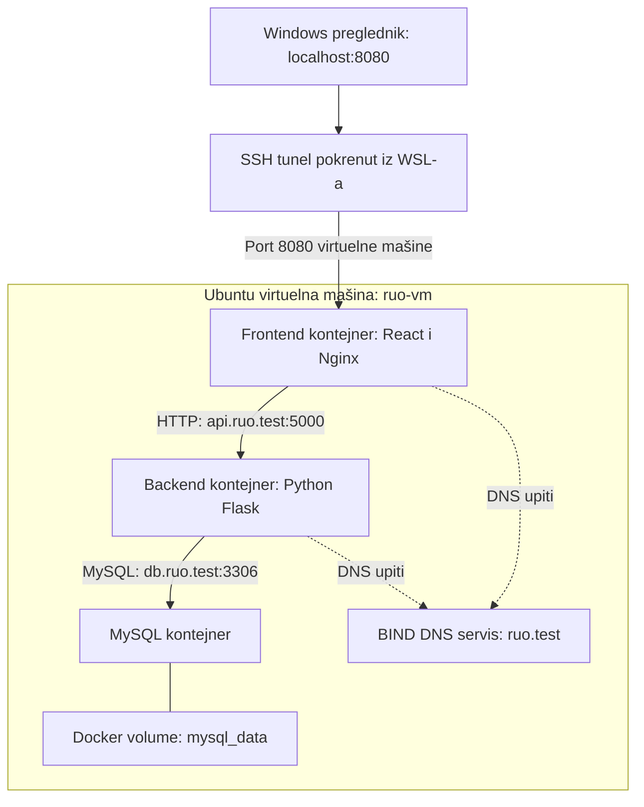

# Automatizovana isporuka troslojne aplikacije

**Predmet:** Računarstvo u oblaku - 2026/27  
**Studentica:** Medina Ferhatović  

Projekt automatizuje kreiranje virtuelne mašine, konfiguraciju servera,
upravljanje DNS zapisima i pokretanje aplikacije.

Koriste se Terraform, cloud-init, Ansible, Docker Compose i BIND.

## 1. Opis aplikacije

Aplikacija omogućava prikaz, dodavanje i brisanje korisnika.

Sastoji se od tri sloja:

- **Frontend:** React aplikacija koju poslužuje Nginx.
- **Backend:** Python Flask API.
- **Baza podataka:** MySQL.

Podaci o korisnicima sadrže identifikator, ime i email adresu.

### Izvor aplikacije

Aplikacija je preuzeta iz repozitorija:

https://github.com/deepikapaneer/react-flask-crud-docker

Izvorni kod prilagođen je zahtjevima projekta. Izmjene su opisane
u dijelu „Izmjene u odnosu na originalnu aplikaciju“.

## 2. Arhitektura

Projekt koristi jednu Ubuntu virtuelnu mašinu.

Na VM-u se nalaze:

- frontend, backend i MySQL kao zasebni Docker kontejneri;
- BIND DNS server kao sistemski servis;
- Docker volume za podatke baze.

Terraform i Ansible pokreću se iz Ubuntu WSL okruženja na laptopu.



Preglednik pristupa frontendu preko SSH tunela.

Nginx poslužuje React aplikaciju. Zahtjeve čija putanja počinje
sa `/api/` prosljeđuje Flask backendu.

Backend pristupa MySQL bazi koristeći DNS ime `db.ruo.test`.

BIND poslužuje projektnu DNS zonu, dok Terraform upravlja DNS
zapisima servisa.

### Virtuelna mašina

| Parametar | Vrijednost |
|---|---|
| Naziv | `ruo-vm` |
| Operativni sistem | Ubuntu 24.04 LTS |
| Memorija | 4096 MiB |
| Procesori | 2 vCPU |
| Disk | 25 GiB |
| Upravljanje | Terraform i libvirt |
| Tip domena | `qemu` |
| Management korisnik | `medina` |
| SSH autentifikacija | SSH ključ |
| IP adresa | Dodjeljuje se preko DHCP-a |

### QEMU i KVM

Na korištenom WSL2 okruženju nije dostupan `/dev/kvm`.

Zbog toga VM koristi `type = "qemu"` i softversku emulaciju bez
KVM ubrzanja. Terraform i dalje kreira virtuelnu mašinu preko
libvirt providera.

Posljedica ovog izbora je sporije izvršavanje. Prva izgradnja
aplikacije može trajati znatno duže zbog preuzimanja slika,
instalacije zavisnosti i izgradnje React aplikacije.

## 3. Plan adresiranja i mrežna izolacija

### Mreže

| Mreža | Podmreža | Namjena |
|---|---|---|
| libvirt `default` | `192.168.122.0/24` | Pristup i upravljanje VM-om |
| Docker `ruo_web` | `172.28.10.0/24` | Web segment |
| Docker `ruo_app` | `172.28.20.0/24` | Komunikacija frontenda i backenda |
| Docker `ruo_db` | `172.28.30.0/24` | Komunikacija backenda i baze |

### Adrese kontejnera

| Kontejner | Mreža | Adresa |
|---|---|---|
| Frontend | `ruo_web` | `172.28.10.10` |
| Frontend | `ruo_app` | `172.28.20.10` |
| Backend | `ruo_app` | `172.28.20.20` |
| Backend | `ruo_db` | `172.28.30.10` |
| MySQL | `ruo_db` | `172.28.30.20` |

### Pravila izolacije

- Frontend i backend dijele aplikacijsku mrežu.
- Backend i MySQL dijele mrežu baze.
- Frontend nije priključen na mrežu baze.
- Mreža baze ima postavljeno `internal: true`.
- Backend ima isključeno IPv4 prosljeđivanje.
- Backend i MySQL nemaju objavljene portove na VM-u.
- Objavljen je samo frontend: `8080:80`.

Poznavanje DNS adrese baze ne omogućava frontendu pristup bazi.
Test izolacije provjerava da frontend može razriješiti naziv baze,
ali ne može uspostaviti vezu prema njenom portu `3306`.

## 4. DNS

BIND je autoritativni DNS server za zonu `ruo.test`.

| DNS zapis | Odredište |
|---|---|
| `ns.ruo.test` | Trenutna IP adresa VM-a |
| `web.ruo.test` | Trenutna IP adresa VM-a |
| `api.ruo.test` | `172.28.20.20` |
| `db.ruo.test` | `172.28.30.20` |

Zapis `web.ruo.test` pokazuje na VM jer je frontend dostupan preko
objavljenog porta VM-a.

Zapisi `api.ruo.test` i `db.ruo.test` koriste se za komunikaciju
unutar projektnog okruženja. To nisu javno dostupne adrese.

### Podjela odgovornosti

**Ansible:**

- instalira BIND;
- postavlja osnovnu konfiguraciju;
- kreira početnu zonu;
- generiše TSIG ključ;
- postavlja dozvole;
- provjerava konfiguraciju i zonu;
- ponovo pokreće BIND kada je potrebno.

**Terraform:**

- koristi `hashicorp/dns` provider;
- autentifikuje DNS izmjene TSIG ključem;
- upravlja zapisima `web`, `api` i `db`;
- otkriva odstupanja između konfiguracije i stvarnih DNS zapisa.

TSIG pravilo ograničeno je na projektnu zonu i tipove zapisa
`A`, `CNAME` i `TXT`.

Početni fajl zone kreira se uz `force: false`, kako kasnija
Ansible izvršavanja ne bi prepisivala dinamičke DNS izmjene.

## 5. Struktura repozitorija

```text
ruo-projekat/
├── Makefile
├── README.md
├── cloud-init/
│   └── user-data.tftpl
├── terraform/
│   ├── vm/
│   │   ├── main.tf
│   │   └── .terraform.lock.hcl
│   └── dns/
│       ├── main.tf
│       └── .terraform.lock.hcl
├── ansible/
│   ├── requirements.yml
│   ├── site.yml
│   └── roles/
│       ├── docker/
│       ├── dns/
│       └── app/
├── app/
│   ├── compose.yaml
│   ├── backend/
│   ├── frontend/
│   └── database/
├── scripts/
│   └── prepare-access.sh
└── tests/
    ├── isolation.sh
    ├── services.sh
    └── results/
```

## 6. Priprema računara

Ovaj dio odnosi se na prvo postavljanje novog računara.

Za postojeće pripremljeno okruženje odnosi se dio „Pokretanje projekta“.

### 6.1. WSL2 i Ubuntu

U Windows CMD-u ili PowerShellu, pokrenutom kao administrator:

```powershell
wsl --list --online
wsl --install -d Ubuntu
```

Ako instalacija zahtijeva ponovno pokretanje računara, restartovati
računar prije nastavka.

Otvoriti Ubuntu i kreirati Linux korisnika i lozinku.

U Windows terminalu provjeriti:

```powershell
wsl --list --verbose
```

Ubuntu treba koristiti WSL verziju `2`.

U Ubuntu terminalu provjeriti:

```bash
ps -p 1 -o comm=
python3 --version
```

Za opisani postupak potrebni su systemd i Python 3.12 ili noviji.

### 6.2. Sistemski paketi

U Ubuntu WSL terminalu:

```bash
sudo apt update

sudo apt install -y \
  git \
  make \
  curl \
  unzip \
  ca-certificates \
  python3 \
  python3-venv \
  pipx \
  openssh-client \
  qemu-system-x86 \
  qemu-utils \
  libvirt-daemon-system \
  libvirt-clients \
  cloud-image-utils
```

Pokrenuti libvirt i dodati korisnika u odgovarajuću grupu:

```bash
sudo systemctl enable --now libvirtd
sudo usermod -aG libvirt "$USER"
```

Zatvoriti i ponovo otvoriti Ubuntu terminal da bi se primijenilo
članstvo u grupi.

Provjeriti pristup:

```bash
virsh -c qemu:///system list --all
```

### 6.3. Libvirt mreža

Provjeriti:

```bash
virsh -c qemu:///system net-list --all
```

Samo ako mreža `default` ne postoji:

```bash
cat > /tmp/ruo-default-network.xml <<'EOF'
<network>
  <name>default</name>
  <forward mode='nat'/>
  <bridge name='virbr0' stp='on' delay='0'/>
  <ip address='192.168.122.1' netmask='255.255.255.0'>
    <dhcp>
      <range start='192.168.122.100' end='192.168.122.254'/>
    </dhcp>
  </ip>
</network>
EOF

virsh -c qemu:///system net-define /tmp/ruo-default-network.xml
```

Ako mreža nije aktivna:

```bash
virsh -c qemu:///system net-start default
```

Uključiti automatsko pokretanje:

```bash
virsh -c qemu:///system net-autostart default
```

### 6.4. Storage pool

Provjeriti:

```bash
virsh -c qemu:///system pool-list --all
```

Ako pool `default` ne postoji:

```bash
sudo mkdir -p /var/lib/libvirt/images

virsh -c qemu:///system pool-define-as \
  default dir \
  --target /var/lib/libvirt/images
```

Ako nije aktivan:

```bash
virsh -c qemu:///system pool-start default
```

Uključiti automatsko pokretanje:

```bash
virsh -c qemu:///system pool-autostart default
```

Mreža i pool predstavljaju početnu pripremu lokalnog libvirt
okruženja i ostaju dostupni nakon uklanjanja projekta.

### 6.5. Terraform

Naredbe su za `linux_amd64` arhitekturu:

```bash
mkdir -p ~/terraform-install
cd ~/terraform-install

curl -fLO \
  https://releases.hashicorp.com/terraform/1.17.2/terraform_1.17.2_linux_amd64.zip

curl -fLO \
  https://releases.hashicorp.com/terraform/1.17.2/terraform_1.17.2_SHA256SUMS

sha256sum --check --ignore-missing \
  terraform_1.17.2_SHA256SUMS
```

Provjera preuzetog ZIP paketa mora završiti sa `OK`.

Zatim:

```bash
unzip -o terraform_1.17.2_linux_amd64.zip
sudo install -m 0755 terraform /usr/local/bin/terraform
terraform version
```

### 6.6. Ansible

Uz Python 3.12 ili noviji:

```bash
pipx install ansible-core==2.20.1
pipx ensurepath
export PATH="$HOME/.local/bin:$PATH"

ansible --version
ansible-playbook --version
```

### 6.7. Preuzimanje projekta

```bash
cd ~

git clone \
  https://github.com/MedinaFerhatovic/ruo-projekat.git

cd ~/ruo-projekat
```

### 6.8. SSH ključ

Provjeriti da li ključ već postoji:

```bash
ls -l ~/.ssh/ruo_projekat ~/.ssh/ruo_projekat.pub
```

Ako ne postoji, generisati ga:

```bash
ssh-keygen \
  -t ed25519 \
  -f ~/.ssh/ruo_projekat \
  -C "ruo-projekat"
```

### 6.9. Ansible kolekcije

```bash
cd ~/ruo-projekat

ansible-galaxy collection install \
  -r ansible/requirements.yml
```

## 7. Pokretanje projekta

Sve naredbe u ovom dijelu izvršavaju se iz root-a repozitorija:

```bash
cd ~/ruo-projekat
```

### Automatsko izvršavanje

```bash
make all
```

Naredba redom provjerava okruženje, kreira VM, priprema pristup,
konfiguriše server, postavlja DNS zapise, isporučuje aplikaciju
i pokreće testove.

### Pojedinačni koraci

| Naredba | Namjena |
|---|---|
| `make check` | Provjera potrebnih alata i libvirt resursa |
| `make infra` | Kreiranje ili pokretanje VM-a i priprema pristupa |
| `make config` | Konfiguracija servera, Docker-a i BIND-a |
| `make dns` | Kreiranje DNS zapisa preko Terraform-a |
| `make deploy` | Prenos, izgradnja i pokretanje aplikacije |
| `make test` | Provjera izolacije, DNS-a i aplikacije |
| `make all` | Svi prethodni koraci redom |
| `make destroy` | Uklanjanje projektnih DNS zapisa i VM-a |

Redoslijed pojedinačnog izvršavanja:

```bash
make check
make infra
make config
make dns
make deploy
make test
```

### Dinamička IP adresa

VM dobija IP adresu preko DHCP-a.

Skripta `scripts/prepare-access.sh`:

1. osvježava Terraform podatke o VM-u;
2. čeka dostupnu IPv4 adresu;
3. generiše Ansible inventory;
4. postavlja trenutnu adresu DNS servera za Terraform;
5. zapisuje adresu u `.runtime/vm-ip`;
6. čeka dostupnost SSH veze.

Nakon ponovne izgradnje nije potrebno ručno prepisivati IP adresu
u inventory i DNS konfiguraciju.

Trenutna adresa:

```bash
cat .runtime/vm-ip
```

### Nakon restarta laptopa

Pokrenuti:

```bash
cd ~/ruo-projekat
make all
```

Postojeći resursi se provjeravaju i usklađuju s konfiguracijom.
Prva izgradnja je sporija; naredna izvršavanja koriste već
preuzete slike i postojeće resurse.

## 8. Pristup aplikaciji

U posebnom WSL terminalu:

```bash
cd ~/ruo-projekat

ssh -i ~/.ssh/ruo_projekat \
  -N \
  -o ExitOnForwardFailure=yes \
  -L 127.0.0.1:8080:127.0.0.1:8080 \
  "medina@$(cat .runtime/vm-ip)"
```

Terminal ostaviti otvoren.

U Windows pregledniku otvoriti:

http://localhost:8080

Zatvaranje tunela prekida pristup preko te lokalne adrese,
ali ne zaustavlja aplikaciju na VM-u.

API se iz WSL-a može provjeriti naredbom:

```bash
curl -i \
  "http://$(cat .runtime/vm-ip):8080/api/users"
```

Očekuje se HTTP `200` i JSON lista korisnika. Prazna baza vraća `[]`.

## 9. Izmjene u odnosu na originalnu aplikaciju

### Organizacija direktorija

Izvorni direktoriji aplikacije preneseni su u:

- `app/frontend`;
- `app/backend`;
- `app/database`.

Izvorni direktorij `db` preimenovan je u `database`.

### Frontend API putanja

Izvorni frontend koristio je:

```javascript
const API = 'http://localhost:5000/users';
```

Promijenjeno je u:

```javascript
const API = '/api/users';
```

Zahtjev sada ide na istu adresu s koje je otvoren frontend,
a Nginx ga prosljeđuje backendu.

Time preglednik ne mora direktno pristupati backend portu.

### Nginx konfiguracija

Dodana je konfiguracija koja:

- poslužuje izgrađenu React aplikaciju;
- podržava učitavanje frontend putanja;
- prosljeđuje `/api/` zahtjeve na `api.ruo.test:5000`.

Primjer:

```text
/api/users → Flask /users
```

Konfiguracija se kopira u frontend Docker sliku.

### Backend konekcije prema bazi

Original je koristio jednu globalnu MySQL konekciju i cursor
kreirane pri pokretanju aplikacije.

Nakon ponovnog kreiranja MySQL kontejnera ta konekcija postala
je nevažeća, što je uzrokovalo HTTP `500` i grešku
„Lost connection to MySQL server during query“.

Backend je izmijenjen tako da:

- konekciju dobija za pojedinačni HTTP zahtjev;
- koristi Flask `g` za čuvanje konekcije tokom zahtjeva;
- zatvara konekciju nakon zahtjeva;
- ne dijeli jedan globalni cursor između zahtjeva;
- obrađuje MySQL greške i vraća generički JSON odgovor sa statusom `503`;
- čita pristupne podatke iz varijabli okruženja;
- radi sa isključenim debug režimom.

Nakon izmjene API je ponovo uspješno radio i poslije ponovnog
kreiranja MySQL kontejnera.

### MySQL slika

Slika `mysql:8.4` nije se pokretala u korištenoj QEMU konfiguraciji.

Prikazana je greška:

```text
Fatal glibc error: CPU does not support x86-64-v2
```

Odabrana je slika:

```text
mysql:8.0.46-debian
```

Ta slika uspješno se pokreće u testiranom okruženju.

### Docker Compose

Konfiguracija je prilagođena tako da:

- svaki sloj radi u zasebnom kontejneru;
- postoje zasebni web, app i db segmenti;
- samo frontend objavljuje port;
- backend i frontend koriste projektni DNS;
- backend pristupa bazi preko `db.ruo.test`;
- baza koristi trajni volume;
- lozinke dolaze iz generisanog `.env` fajla;
- backend čeka uspješan healthcheck baze.

### Healthcheck baze

Početna provjera nije dovoljno pouzdano potvrđivala spremnost baze
za aplikacijske upite tokom prvog pokretanja.

Healthcheck je prilagođen da preko TCP veze, koristeći aplikacijskog
korisnika, izvrši upit nad tabelom `users`.

Time se provjeravaju dostupnost servera, autentifikacija, baza i tabela
potrebna aplikaciji.

## 10. Sigurnost i upravljanje tajnama

### SSH pristup

Cloud-init postavlja:

- management korisnika `medina`;
- autentifikaciju javnim SSH ključem;
- isključenu SSH autentifikaciju lozinkom;
- onemogućen direktan pristup root korisniku.

### Lozinke baze

Lozinke se generišu pri izvršavanju Ansible konfiguracije.

Lokalno se čuvaju izvan repozitorija:

```text
~/.config/ruo/mysql-password
~/.config/ruo/mysql-root-password
```

Za aplikaciju se generiše:

```text
/opt/ruo/.env
```

Taj fajl na VM-u ima ograničene dozvole pristupa.

`ansible/roles/app/templates/app.env.j2` sadrži upute
za generisanje konfiguracije.

### TSIG ključ

TSIG ključ generiše se na VM-u:

```text
/etc/bind/ruo-tf.key
```

Kopija potrebna Terraform-u preuzima se lokalno:

```text
~/.config/ruo/ruo-tf.key
```

Ključ nije dio repozitorija.

Ansible zadaci koji obrađuju tajne koriste `no_log` gdje je potrebno.

### Datoteke izostavljene iz Git-a

Ne verzionišu se:

- Terraform state i njegove sigurnosne kopije;
- direktoriji `.terraform/`;
- spremljeni Terraform planovi;
- stvarni `.env` fajlovi;
- privatni SSH i TSIG ključevi;
- lokalne datoteke s lozinkama;
- generisani Ansible inventory;
- trenutna IP adresa VM-a;
- generisani runtime Terraform parametri;
- VM diskovi i ISO datoteke.

Datoteke `.terraform.lock.hcl` verzionišu se radi zaključavanja
verzija providera.

Provjera ignorisanja:

```bash
git check-ignore \
  terraform/vm/terraform.tfstate \
  terraform/dns/terraform.tfstate \
  ansible/inventory.ini \
  .runtime/vm-ip \
  terraform/dns/runtime.auto.tfvars.json
```

## 11. Testovi i dokazi

Pokretanje svih automatizovanih testova:

```bash
make test
```

Rezultati se zapisuju u `tests/results/`.

### 11.1. Mrežna izolacija

```bash
bash tests/isolation.sh "$(cat .runtime/vm-ip)"
```

Provjerava se:

- backend može pristupiti bazi;
- frontend razrješava DNS ime baze;
- frontend ne može pristupiti bazi na portu `3306`;
- backend i baza nemaju objavljene portove.

Primjer uspješnog izlaza:

```text
Provjera: backend -> baza
USPJEH: backend pristupa bazi
Provjera: frontend -> baza
DNS adresa baze: 172.28.30.20
USPJEH: frontend nema pristup bazi
Provjera: backend i baza nemaju objavljene portove
USPJEH: svi testovi izolacije su prosli
```

[Potpuni rezultat](tests/results/isolation.txt)

### 11.2. DNS i dostupnost aplikacije

```bash
bash tests/services.sh "$(cat .runtime/vm-ip)"
```

Provjerava se:

- `api.ruo.test` vraća `172.28.20.20`;
- `db.ruo.test` vraća `172.28.30.20`;
- `web.ruo.test` vraća trenutnu adresu VM-a;
- frontend odgovara na HTTP zahtjev;
- API vraća JSON listu korisnika.

Primjer završetka:

```text
USPJEH: frontend odgovara
USPJEH: API vraca JSON listu korisnika
USPJEH: svi testovi servisa su prosli
```

[Potpuni rezultat](tests/results/services.txt)

### 11.3. Idempotentnost Ansible konfiguracije

Nakon uspješnog podizanja, konfiguracija je izvršena ponovo.

Ponovljeno izvršavanje bez promjene konfiguracije završilo je sa:

```text
changed=0
unreachable=0
failed=0
```

Dokazi:

- [Drugo izvršavanje Ansible playbooka](tests/results/ansible-second-run.txt)
- [Drugo izvršavanje make all](tests/results/make-all-second-run.txt)

### 11.4. DNS drift

Drift je demonstriran promjenom TTL vrijednosti zapisa
`api.ruo.test` izvan Terraform-a.

Početna deklarisana vrijednost je `300`, a namjerno postavljena
vrijednost je `60`.

Za ponavljanje demonstracije:

```bash
ssh -i ~/.ssh/ruo_projekat \
  "medina@$(cat .runtime/vm-ip)" \
  'sudo nsupdate -k /etc/bind/ruo-tf.key' <<'EOF'
server 127.0.0.1
zone ruo.test.
update delete api.ruo.test. A
update add api.ruo.test. 60 A 172.28.20.20
send
EOF
```

Provjeriti odstupanje:

```bash
terraform -chdir=terraform/dns plan
```

Relevantni dio plana:

```text
ttl = 60 -> 300 # forces replacement

Plan: 1 to add, 0 to change, 1 to destroy.
```

Ispraviti:

```bash
terraform -chdir=terraform/dns apply
```

Ponovo provjeriti:

```bash
terraform -chdir=terraform/dns plan
```

Očekivani rezultat:

```text
No changes. Your infrastructure matches the configuration.
```

Zamjena se odnosi na DNS zapis, a ne na VM ili kontejnere.

Dokazi:

- [Plan sa DNS driftom](tests/results/dns-drift-plan.txt)
- [Plan nakon ispravke](tests/results/dns-after-fix.txt)

### 11.5. Trajnost podataka baze

Postupak provjere:

1. U aplikaciji dodati korisnika.
2. Osvježiti stranicu i provjeriti prikaz korisnika.
3. Ponovo kreirati MySQL kontejner bez uklanjanja volume-a.
4. Ponovo provjeriti API i prikaz korisnika.

Naredba za ponovno kreiranje MySQL kontejnera:

```bash
ssh -i ~/.ssh/ruo_projekat \
  "medina@$(cat .runtime/vm-ip)" \
  "sudo docker compose \
  --project-directory /opt/ruo \
  -f /opt/ruo/compose.yaml \
  up -d --force-recreate \
  --wait --wait-timeout 300 mysql"
```

Provjera API-ja:

```bash
curl -i \
  "http://$(cat .runtime/vm-ip):8080/api/users"
```

U provedenoj provjeri korisnik je ostao sačuvan, a API je vratio
HTTP `200` i isti zapis korisnika.

Docker volume čuva podatke pri zamjeni kontejnera.
Uklanjanje cijele VM uklanja i podatke na njenom disku.

### 11.6. Ponovna izgradnja

Projekt je uklonjen i ponovo podignut.

Nakon ponovne izgradnje prošli su testovi izolacije, DNS-a
i dostupnosti aplikacije.

Dokazi:

- [Uklanjanje resursa](tests/results/destroy.txt)
- [Ponovna izgradnja](tests/results/rebuild.txt)

## 12. Uklanjanje projekta

Iz korijena repozitorija:

```bash
make destroy
```

Postupak prvo uklanja Terraform DNS zapise, a zatim VM i
projektne diskove.

VM i BIND trebaju biti dostupni prilikom uklanjanja DNS zapisa.
Ako je laptop prethodno restartovan, prvo pokrenuti:

```bash
make infra
```

Zatim:

```bash
make destroy
```

Uklanjanjem VM-a gube se podaci baze na njenom disku.
Podatke koje treba sačuvati prethodno izvesti u sigurnosnu kopiju.

`make destroy` zadržava:

- izvorni kod;
- instalirane alate;
- pripremljenu libvirt mrežu i storage pool;
- lokalni SSH ključ;
- lokalne datoteke s generisanim tajnama.

Za ponovno podizanje:

```bash
make all
```

## 13. Dijagnostika

### Provjera stanja VM-a

```bash
virsh -c qemu:///system list --all
```

### Provjera trenutne adrese

```bash
cat .runtime/vm-ip
```

### SSH pristup

```bash
ssh -i ~/.ssh/ruo_projekat \
  "medina@$(cat .runtime/vm-ip)"
```

### Provjera kontejnera

```bash
ssh -i ~/.ssh/ruo_projekat \
  "medina@$(cat .runtime/vm-ip)" \
  "sudo docker compose \
  --project-directory /opt/ruo \
  -f /opt/ruo/compose.yaml ps -a"
```

### Logovi aplikacije

```bash
ssh -i ~/.ssh/ruo_projekat \
  "medina@$(cat .runtime/vm-ip)" \
  "sudo docker compose \
  --project-directory /opt/ruo \
  -f /opt/ruo/compose.yaml logs --tail=80"
```

### Provjera DNS-a

```bash
ssh -i ~/.ssh/ruo_projekat \
  "medina@$(cat .runtime/vm-ip)" \
  "dig @127.0.0.1 api.ruo.test A"
```

### Provjera Terraform konfiguracije

```bash
terraform -chdir=terraform/vm validate
terraform -chdir=terraform/dns validate

terraform -chdir=terraform/vm plan
terraform -chdir=terraform/dns plan
```

Nakon uspješnog usklađivanja očekuje se `No changes`.

### Spora prva izgradnja

Prvo izvršavanje može trajati duže jer uključuje:

- preuzimanje Ubuntu cloud slike;
- instalaciju paketa na VM-u;
- preuzimanje Docker slika;
- instalaciju Python i JavaScript zavisnosti;
- izgradnju React aplikacije;
- inicijalizaciju MySQL baze.

Softverska QEMU emulacija dodatno povećava trajanje.

Parametar čekanja spremnosti kontejnera ne predstavlja ukupno
vremensko ograničenje izgradnje Docker slika.

## 14. Verzije korištene u provjeri

| Komponenta | Verzija ili izbor |
|---|---|
| Terraform | `1.17.2` |
| Ansible-core | `2.20.1` |
| Libvirt Terraform provider | `dmacvicar/libvirt 0.8.3` |
| DNS Terraform provider | `hashicorp/dns`, ograničenje `~> 3.4` |
| Gostujući operativni sistem | Ubuntu 24.04 LTS |
| Backend osnovna slika | `python:3.10-slim` |
| MySQL slika | `mysql:8.0.46-debian` |

Tačne odabrane verzije Terraform providera sačuvane su u
datotekama `.terraform.lock.hcl`.

Ubuntu cloud slika preuzima se sa putanje `current`.